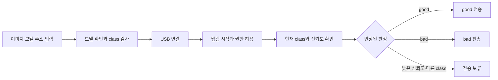

# 마이크로비트 AI 자세 알리미: 웹페이지 설계

작성일: 2026-09-29  
단계: 구현 전 설계  
참고 기준: [1편 저장소](https://github.com/WBmaker2/microbit-ai-project1) `bc73927b7131b3d52d29f8c5cf3fcfb7f7d9f19c`, [공개 화면](https://wbmaker2.github.io/microbit-ai-project1/)

## 1. 목적과 범위

학생이 Teachable Machine **이미지 모델**의 주소를 입력하고 웹캠으로 자세를 비추면, 웹페이지가 모델의 `good` 또는 `bad` class를 판정하여 USB 시리얼로 micro:bit에 전송한다. 사용자가 micro:bit 수신 코드를 별도로 작성하므로 이 프로젝트에는 MakeCode 프로그램이나 HEX 파일을 포함하지 않는다.

이미지 분류는 화면 전체의 학습 예시와 유사도를 판정한다. 관절 위치를 측정하거나 의학적으로 올바른 자세를 진단하는 기능으로 설명하지 않는다. 학생이 `good`, `bad`를 학습시킨 카메라 위치·거리·조명에서만 결과를 신뢰하도록 안내한다.

## 2. 1편에서 이어받는 것과 바꾸는 것

| 영역 | 이어받을 내용 | 2편에서 변경할 내용 |
| --- | --- | --- |
| 기술 구조 | React, Vite, 역할별 CSS, Home/AI 두 화면, 업데이트 내역 | 프로젝트 이름과 GitHub Pages base를 `microbit-ai-project2`로 변경 |
| USB | Web Serial 포트 선택, 115200 baud, 연결 상태, 전송 대기열, 연결 해제 | 수동 테스트를 `good`/`bad`로 제한하고 줄 단위 명령을 전송 |
| 모델 설정 | HTTPS 주소 정규화, `metadata.json` 사전 확인, class 목록, 신뢰도 설정 | 이미지 모델 라이브러리와 `good`/`bad` class 검사로 변경 |
| 추론 | 판정 임계값, 동일 명령 간격 제어, 현재 class/최근 전송 표시 | 마이크 추론을 웹캠 추론으로 교체하고 짧은 안정화 시간을 추가 |
| 디자인 | 밝은 파랑·청록·코랄 색상, 카드형 패널, 상태 배지, 반응형 구성 | 선풍기·마이크 그림과 문구를 웹캠·자세·알림 그림과 문구로 변경 |

1편의 음성 모델용 `speechCommands` API와 `wordLabels` 의존 코드는 그대로 사용하지 않는다. 이미지 모델은 [Teachable Machine 공식 이미지 라이브러리](https://github.com/googlecreativelab/teachablemachine-community/tree/master/libraries/image)의 `tmImage.load(model.json, metadata.json)`, `tmImage.Webcam`, `model.predict(webcam.canvas)` 흐름으로 구현한다. webcam의 `stop()`으로 카메라 트랙을 종료한다.

## 3. 학생 사용 흐름



- **Home:** 연결, 수동 `good`/`bad` 전송, 연결 해제, 웹캠·micro:bit·LED 관계를 보여주는 삽화. 첫 실습은 AI 없이 두 명령을 보내어 연결을 확인한다.
- **자세 인식:** 모델 주소 확인 → class 목록 → 신뢰도 적용 → USB 연결 → 카메라 시작/정지 → 실시간 미리보기와 현재 class·신뢰도·최근 전송값을 보여준다.
- **중요한 다음 단계 버튼:** 현재 필요한 `모델 확인`, `연결`, `시작`에만 부드러운 `gi-pulse` 효과를 준다. 사용 완료·비활성 상태에는 효과를 끄고 `prefers-reduced-motion`을 존중한다.
- **업데이트 내역:** 2편 최초 작성일과 이후 개선일을 헤더의 작은 버튼에 누적한다.

## 4. 모델 및 판정 계약

1. HTTPS 모델 폴더 주소를 입력받아 `metadata.json`을 확인한다. `labels`에 `good`, `bad`가 각각 정확히 하나씩 있어야 한다. 비교할 때 앞뒤 공백과 대소문자를 정규화하고, 중복·누락 시 어떤 class를 고쳐야 하는지 보여준다.
2. 선택적인 세 번째 class(예: `other`, `empty`)는 화면에 표시하되 전송하지 않는다. 두 class만 학습한 모델은 빈 화면도 억지로 `good` 또는 `bad`로 분류할 수 있으므로 학습 안내에 빈 자리·옆 사람·가림 장면을 별도 class로 추가하도록 권한다.
3. 기본 신뢰도는 90%이며 사용자가 0~100 정수로 바꿀 수 있다. 가장 높은 class의 확률이 기준 미만이면 전송하지 않는다.
4. 웹캠은 약 5회/초로 추론을 제한한다. 같은 명령 후보가 약 600ms 동안 유지되면 안정된 판정으로 인정한다. 이는 한 프레임의 흔들림이 경보를 켜거나 끄지 않도록 하기 위한 초기값이며 실제 수업 환경에서 조정한다.
5. 안정된 class가 바뀌면 즉시 전송하고, 같은 class는 최대 약 1.5초에 한 번 다시 보낸다. 연결 재시작 후에는 현재 안정된 class를 새 세션에서 다시 전송한다. 전송 중에 들어온 예측은 오래된 명령이 뒤늦게 쌓이지 않도록 합친다.
6. 카메라가 멈추거나 권한이 철회되거나 모델 결과가 불확실할 때는 `good`을 꾸며 보내지 않는다. 이때 웹페이지는 판정/전송을 중지하고 상태를 알려준다. micro:bit 쪽에서 수신이 끊긴 경우 경보를 멈추는 타임아웃을 두는 것이 좋다. 해당 동작은 사용자 측 코딩 범위다.

## 5. USB 시리얼 계약

전송 문자열은 UTF-8의 **`good\n` 또는 `bad\n`** 둘뿐이다. 화면에는 명령 이름 `good`/`bad`를 표시한다. 줄바꿈은 두 명령이 이어 붙어도 micro:bit가 한 줄씩 구분할 수 있게 하는 구분자다. 1편의 줄바꿈 없는 `on`/`off`와 달라지는 점을 Home 화면과 README에 명시한다. 포트 속도는 1편과 같은 **115200 baud**다. 수신 측은 개행으로 나눈 한 줄을 읽어 `good` 또는 `bad`와 비교하면 된다. [MakeCode의 시리얼 수신 이벤트](https://makecode.microbit.org/reference/serial/on-data-received)와 [한 줄 읽기](https://makecode.microbit.org/reference/serial/read-line)가 이 형식을 지원한다.

연결 실패, 장치 분리, 카메라 권한 거부, 모델 로딩 실패 시 상태와 복구 방법을 보여준다. Chrome 또는 Edge의 HTTPS/localhost에서 카메라와 Web Serial을 사용한다. 실제 카메라 프레임과 예측 결과를 앱 서버에 저장하거나 업로드하지 않는다. Teachable Machine 모델과 실행 라이브러리를 받아오려면 인터넷 연결이 필요하다.

## 6. 예정 파일 구조

```text
src/
  app/App.jsx                 공통 연결 상태와 화면 전환
  components/                헤더, 연결 배지, 업데이트 내역, 기기 삽화
  features/ai/               모델 URL·metadata, 이미지 모델/웹캠 훅, 판정 정책
  features/serial/           기존 USB 연결 훅과 줄 단위 명령
  pages/HomePage.jsx         수동 전송 실습
  pages/AiPosturePage.jsx    이미지 모델 설정·웹캠·판정
  styles/                    기존 디자인 토큰과 반응형 스타일
```

각 코드 파일은 500줄 미만으로 유지한다. 일러스트는 1편의 CSS·아이콘 방식으로 새 맥락에 맞게 그리며, 실제 웹캠 미리보기를 화면의 주 시각 자료로 쓴다.

## 7. 완료 기준

- 모델 URL 검증과 `good`/`bad` 누락 안내가 동작한다.
- 카메라 시작·정지·화면 이동 시 웹캠 트랙이 적절히 시작·종료된다.
- 현재 class와 신뢰도는 계속 보이되, 임계값 미달과 다른 class는 전송되지 않는다.
- 수동 전송과 AI 전송 모두 `good\n`/`bad\n`만 보내며 연결 재시작과 쓰기 실패를 처리한다.
- 320px, 375px, 1280px에서 페이지가 가로로 넘치지 않고 주요 버튼·상태를 읽을 수 있다.
- 키보드 조작, 초점, 오류 알림, 움직임 줄이기 설정을 확인한다. VoiceOver 검증은 범위에서 제외한다.
- `npm test`, `npm run lint`, `npm run build`를 통과하고, 로컬 브라우저에서 Home → 모델 확인 → 카메라 시작/정지 흐름을 확인한다. 실제 micro:bit 수신·소리·LED 동작은 사용자가 작성할 장치 코드와 하드웨어가 있어야 최종 확인할 수 있다.

## 8. 참고 자료

- [1편 코드와 README](https://github.com/WBmaker2/microbit-ai-project1)
- [1편 공개 페이지](https://wbmaker2.github.io/microbit-ai-project1/)
- [Teachable Machine 이미지 라이브러리](https://github.com/googlecreativelab/teachablemachine-community/tree/master/libraries/image)
- [이미지 라이브러리의 웹캠 구현](https://github.com/googlecreativelab/teachablemachine-community/blob/master/libraries/image/src/utils/webcam.ts)
- [MakeCode 시리얼 수신 이벤트](https://makecode.microbit.org/reference/serial/on-data-received)
- [MakeCode 한 줄 읽기](https://makecode.microbit.org/reference/serial/read-line)
